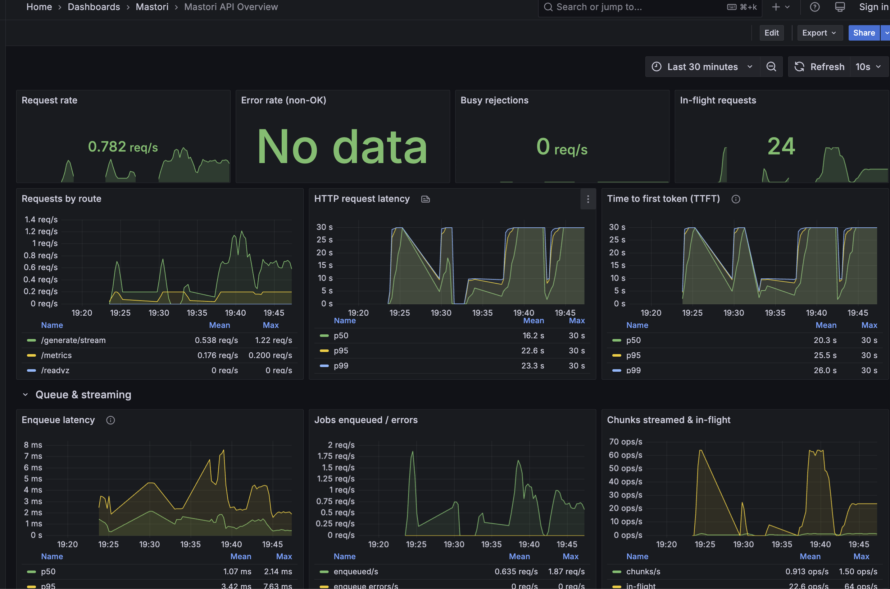

# Mastori

A benchmarking platform for LLM inference on GPU infrastructure.

Run the same LLM workload on identical GPU resources across different providers — AWS, Azure, Nebius, Verda, or any other — and compare throughput, latency, utilization, and cost.

> **Status: early implementation.** The local stack runs end to end with mock workers: a Go API with synchronous and streaming generation, a Redis job queue, a traffic generator (`cmd/traffic`), dataset fetch/validation (`benchmark/workloads`), Prometheus metrics, and Grafana dashboards — deployable on Docker Compose or a local kind cluster. Real vLLM workers, scheduling policies, and cloud providers are still ahead. See the [design document](gpu-inference-benchmarking-platform.md) for the full plan.



## What it will do

- Serve LLM workloads on Kubernetes with vLLM workers
- Route requests through a Go API, Redis queue, and a Go scheduler with pluggable policies (round-robin, least-loaded, queue-aware)
- Generate configurable traffic (rate, duration, workload mix) for repeatable experiments
- Collect metrics from the API, scheduler, queue, vLLM, and GPUs via Prometheus and Grafana
- Abstract the provider behind a common interface so experiments run unchanged on different GPU clouds

## Planned experiments

- Baseline serving and saturation point
- Mixed workloads and their p95/p99 impact
- Scheduler policy comparison
- GPU scaling (1 → 2 → 4 GPUs)
- Quantization tradeoffs (FP16 vs FP8: performance, memory, quality, cost)
- The same experiments across providers

## Roadmap

1. ~~Local stack: Go API → Redis → Go scheduler → mock workers~~
2. ~~Kubernetes with Prometheus and Grafana~~
3. ~~Traffic generator and workload profiles~~
4. Real local inference workers
5. Cloud deployment (CPU + GPU pools) with IaC
6. Cross-provider experiments

## Running locally

All host ports are in the 7000–7999 range.

### Docker Compose

```sh
make compose-up
```

Runs the API (7080), Redis (7079), Prometheus (7090) with mock workers pulling jobs from Redis. Note: the kind cluster also maps API 7080, so only one stack can own it at a time.

### kind

```sh
make cluster-up        # kind create cluster (extraPortMappings: API 7080, Grafana 7081)
make cluster-deploy    # build + load image, apply deploy/kubernetes/
```

The cluster runs API (2 replicas), Redis, mock workers, Prometheus, and Grafana in the `mastori` namespace, plus the OTel collector and Grafana Tempo in `observability`. Dashboards and the Tempo datasource are provisioned automatically; open http://localhost:7081 (anonymous admin login).

### Metrics

The API exposes Prometheus metrics on `/metrics`: request rate and latency by route, time to first token, enqueue latency, jobs enqueued/errors, in-flight requests, chunks streamed, and busy rejections. The provisioned "Mastori API Overview" dashboard covers all of them.

### Traces

The API emits OpenTelemetry traces to the OTel collector (`deploy/otel/collector-config.yaml`), which forwards them to Grafana Tempo (`deploy/tempo/tempo.yaml`, local storage). In the kind cluster both run in the `observability` namespace (`deploy/kubernetes/observability.yaml`); the cluster Grafana has a provisioned Tempo datasource: open http://localhost:7081 → Explore → Tempo and search for traces from `mastori-api` (e.g. the `api.generate` root span), or paste a `trace_id` from the API logs.

### Datasets

Benchmark prompts live in `benchmark/workloads/datasets.yaml`. Fetch and validate them with:

```sh
go run ./cmd/datasets fetch
go run ./cmd/datasets validate
```

### Traffic generation

`cmd/traffic` replays dataset prompts against the API at a controlled rate and writes per-request results as JSONL plus a run summary:

```sh
go run ./cmd/traffic --workload short --rate 10 --duration 5m
go run ./cmd/traffic --workload mixed --short-percentage 80 --rate 50 --duration 10m
go run ./cmd/traffic --workload mixed --steps "10:60s,50:60s,10:60s"
```

Open loop (`--rate`, constant or poisson arrivals, optional `--ramp-end-rate` or `--steps` patterns) or closed loop (`--concurrency`), streaming SSE by default (`--stream=false` for blocking requests), with warmup, seed, and per-request timeout controls.

## License

[MIT](LICENSE)
