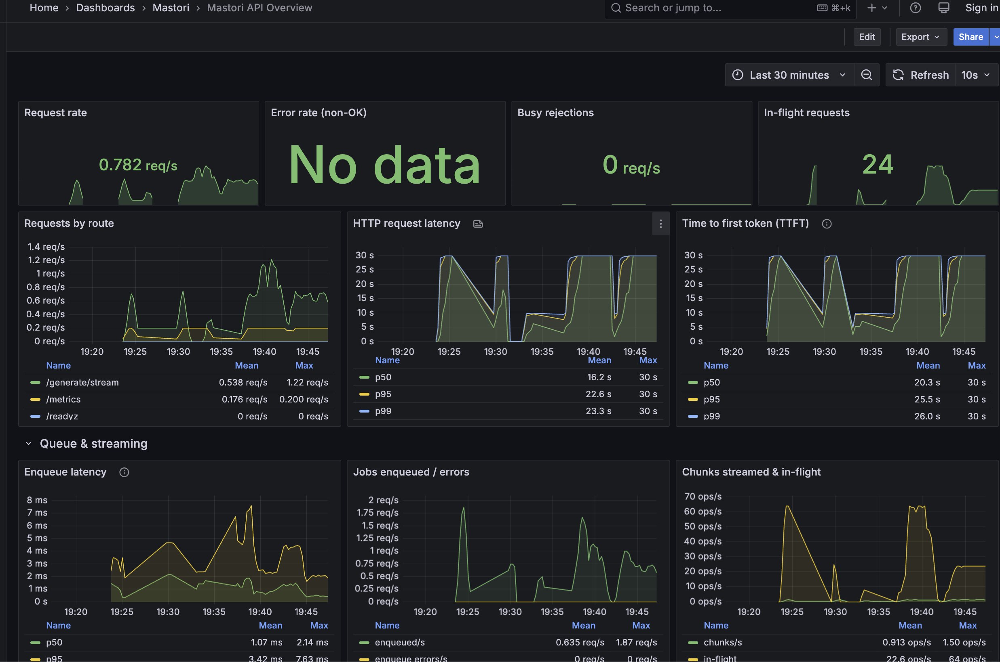

# Mastori

A benchmarking platform for LLM inference on GPU infrastructure.

Run the same LLM workload on identical GPU resources across different providers — AWS, Azure, Nebius, Verda, or any other — and compare throughput, latency, utilization, and cost.

> **Status: early implementation.** The local stack runs end to end with mock workers: a Go API with synchronous and streaming generation, a Redis job queue, a traffic generator (`cmd/traffic`), dataset fetch/validation (`benchmark/workloads`), Prometheus metrics, and Grafana dashboards — deployed on a local kind cluster. An optional inference layer adds real local generation: a vLLM-compatible adapter (`cmd/adapter`) backed by host Ollama plus a real inference worker (`cmd/vllmworker`) that speaks the same API surface a cloud vLLM server will. Scheduling policies and cloud providers are still ahead. See the [design document](gpu-inference-benchmarking-platform.md) for the full plan. Benchmark results are published to [the GitHub Pages site](https://dbaltas.github.io/mastori/).



## What it will do

- Serve LLM workloads on Kubernetes with vLLM workers
- Route requests through a Go API, Redis queue, and a Go scheduler with pluggable policies (round-robin, least-loaded, queue-aware)
- Generate configurable traffic (rate, duration, workload mix) for repeatable experiments
- Collect metrics from the API, scheduler, queue, vLLM, and GPUs via Prometheus and Grafana
- Abstract the provider behind a common interface so experiments run unchanged on different GPU clouds

## Planned experiments

- Baseline serving and saturation point
- Mixed workloads and their p95/p99 impact
- Scheduler policy comparison
- GPU scaling (1 → 2 → 4 GPUs)
- Quantization tradeoffs (FP16 vs FP8: performance, memory, quality, cost)
- The same experiments across providers

## Roadmap

1. ~~Local stack: Go API → Redis → Go scheduler → mock workers~~
2. ~~Kubernetes with Prometheus and Grafana~~
3. ~~Traffic generator and workload profiles~~
4. ~~Real local inference workers (Ollama behind a vLLM-compatible adapter)~~
5. Cloud deployment with mock workers (CPU pool, IaC)
6. Cloud deployment with GPU inference (GPU pool, vLLM)
7. Cross-provider experiments

## Running locally

All host ports are in the 7000–7999 range.

### kind

```sh
make cluster-up        # kind create cluster (extraPortMappings: API 7080, Grafana 7081)
make cluster-deploy    # build + load image, apply the kustomize local overlay (deploy/kubernetes/overlays/local)
```

The cluster runs API (2 replicas), Redis, the scheduler, mock workers, Prometheus, and Grafana in the `mastori` namespace, plus the OTel collector and Grafana Tempo in `observability`. Workloads are placed by `mastori/pool` node labels: everything non-GPU targets the `cpu` pool, and the two `gpu` workers carry the `mastori/gpu=true:NoSchedule` taint that only the inference overlay workloads tolerate. Dashboards and the Tempo datasource are provisioned automatically; open http://localhost:7081 (anonymous admin login).

### Real local inference (Ollama)

Run Ollama on the host first (`ollama pull qwen2.5:0.5b`), then deploy the inference layer into the cluster:

```sh
make cluster-deploy-inference   # apply the inference overlay (deploy/kubernetes/overlays/inference: adapter + vllmworker)
```

The adapter reaches host Ollama via `host.docker.internal` (see `deploy/kubernetes/overlays/inference/adapter.yaml`) so generation runs on the host's Metal GPU; scheduling, queueing, and metrics all stay in-cluster. The adapter serves `POST /v1/completions`, `POST /v1/chat/completions`, `GET /v1/models`, `GET /health`, and a `/metrics` endpoint with synthesized `vllm:*` Prometheus metrics (TTFT, TPOT, e2e latency, token counters), so anything written against a vLLM OpenAI server works unchanged. Set `INFERENCE_MODEL=<model>` to pick the model (default `qwen2.5:0.5b`). Mock and inference workers can run side by side; the scheduler routes jobs to both like any other registered worker.

Port-forward the adapter to try it directly:

```sh
kubectl -n mastori port-forward svc/inference-adapter 7082:8080 &
curl -s localhost:7082/v1/completions -d '{"prompt":"Explain Redis streams","max_tokens":32}' | jq
```

Local runs are functional tests and relative comparisons only — numbers are not comparable to cloud vLLM results and are excluded from cross-provider benchmarks.

### Scheduler

Workers no longer pull from the shared `jobs` stream. The scheduler (`cmd/scheduler`) is its only reader: it picks a live worker with the configured policy and moves the job to that worker's private stream (`jobs:worker:<id>`) in one atomic Redis transaction. Workers read only their own stream and delete an entry when the job finishes.

```
API --XADD--> jobs --scheduler--> jobs:worker:<id> --> worker --XADD--> jobs:chunks:<job_id> --> API
```

- **Registry.** Workers heartbeat a hash `workers:<id>` with a 3-heartbeat TTL (`WORKER_HEARTBEAT_MS`, default 1s). A worker that stops heartbeating drops out of scheduling when the key expires. A gracefully stopped worker deregisters immediately. `WORKER_MODELS` (comma-separated) restricts which models a worker serves; empty serves any.
- **Policies.** `SCHEDULER_POLICY` selects `round-robin` (default) or `least-loaded`. Load is the length of the worker's stream: queued plus running jobs.
- **No workers.** Jobs stay in `jobs` until a worker is available. Jobs older than `SCHEDULER_JOB_TTL` seconds (default 60, 0 disables) are dropped, since the API has already timed out.
- **Metrics** (`:8081/metrics`): `mastori_scheduler_dispatched_total{worker}`, `dispatch_errors_total{reason}`, `jobs_dropped_total{reason}`, `scheduling_seconds`, `queue_wait_seconds`, `queue_depth`, `workers_healthy`, `worker_queue_depth{worker}`.
- **Not yet handled.** Jobs already dispatched to a worker that crashes are not reclaimed or re-dispatched, and a dead worker's stream is not cleaned up. Multiple scheduler replicas are safe (shared consumer group), but each worker-list read is cached for 250ms, so policies see slightly stale membership.

### Tests

```sh
make test              # unit tests (miniredis, no external services)
make test-integration  # API -> Redis -> scheduler -> workers against a real Redis (needs Docker)
```

### Metrics

The API exposes Prometheus metrics on `/metrics`: request rate and latency by route, time to first token, enqueue latency, jobs enqueued/errors, in-flight requests, chunks streamed, and busy rejections. The provisioned "Mastori API Overview" dashboard covers all of them.

### Traces

The API emits OpenTelemetry traces to the OTel collector (`deploy/otel/collector-config.yaml`), which forwards them to Grafana Tempo (`deploy/tempo/tempo.yaml`, local storage). In the kind cluster both run in the `observability` namespace (`deploy/kubernetes/base/observability.yaml`); the cluster Grafana has a provisioned Tempo datasource: open http://localhost:7081 → Explore → Tempo and search for traces from `mastori-api` (e.g. the `api.generate` root span), or paste a `trace_id` from the API logs.

### Datasets

Benchmark prompts live in `benchmark/workloads/datasets.yaml`. The `benchmark/` directory is a git submodule of the [Hugging Face dataset repo](https://huggingface.co/datasets/dbaltas/inference-api-benchmark-mastori), which holds the dataset definitions, experiment configs, and results. Clone with submodules (or run `git submodule update --init --recursive`) before fetching:

```sh
go run ./cmd/datasets fetch
go run ./cmd/datasets validate
```

### Results site

Published experiment results and stories are rendered by `cmd/sitegen` and deployed to GitHub Pages on every push to `main` (see `.github/workflows/pages.yml`): **https://dbaltas.github.io/mastori/**

### Traffic generation

The traffic generator runs inside the cluster as a Kubernetes Job (same image, `mastori/api:latest`, `command: ["/traffic"]`), replaying dataset prompts against the in-cluster API:

```sh
make cluster-run-traffic TRAFFIC_WORKLOAD=short TRAFFIC_RATE=5 TRAFFIC_DURATION=5s
make cluster-traffic-results   # recover the records + summary from the pod logs
```

The run is a Job in the `mastori` namespace: `datasets` initContainers fetch the dataset cache from Hugging Face into an `emptyDir` and validate it, then `/traffic` replays it against `api.mastori.svc.cluster.local:80`. The manifest comes from the benchmark submodule — `cluster-run-traffic` generates the `datasets-manifest` ConfigMap straight from `benchmark/workloads/datasets.yaml`, so the submodule stays the single source of truth for seed data, and the run summary records its SHA-256 (`dataset_manifest_sha256`) as provenance. Run parameters are `TRAFFIC_*` make variables (`TRAFFIC_WORKLOAD`, `TRAFFIC_RATE`, `TRAFFIC_ARRIVAL`, `TRAFFIC_DURATION`, `TRAFFIC_STEPS`, `TRAFFIC_CONCURRENCY`, `TRAFFIC_WARMUP`, `TRAFFIC_SHORT_PERCENTAGE`, `TRAFFIC_SEED`, `TRAFFIC_WAIT_TIMEOUT`), written into the `traffic-config` ConfigMap. Records are streamed to the container stdout (the distroless image has no shell for `kubectl cp`), so `cluster-traffic-results` recovers `benchmark/results/cluster/<run-id>.jsonl` and the run summary from the pod logs. The scheduler-side interruption flag invalidates runs that overlap infrastructure changes, exactly as for host runs.

For host-side runs (`go run ./cmd/traffic`) the same flags are available on the command line; `TRAFFIC_*` environment variables configure the run without flags, and flags win over the environment:

```sh
go run ./cmd/traffic --workload short --rate 10 --duration 5m
go run ./cmd/traffic --workload mixed --short-percentage 80 --rate 50 --duration 10m
go run ./cmd/traffic --workload mixed --steps "10:60s,50:60s,10:60s"
```

Open loop (`--rate`, constant or poisson arrivals, optional `--ramp-end-rate` or `--steps` patterns) or closed loop (`--concurrency`), streaming SSE by default (`--stream=false` for blocking requests), with warmup, seed, and per-request timeout controls. `--manifest` points at the dataset manifest so the run summary records its SHA-256 as seed-data provenance (set automatically by the in-cluster flow).

## License

[MIT](LICENSE)
